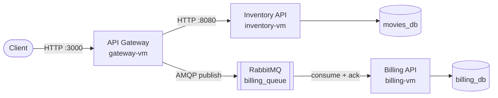
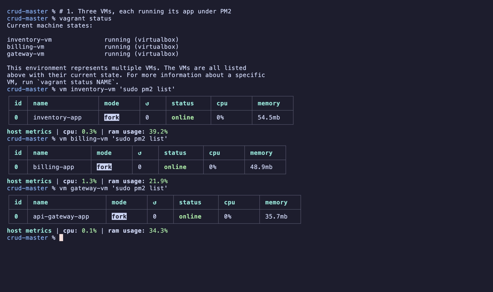
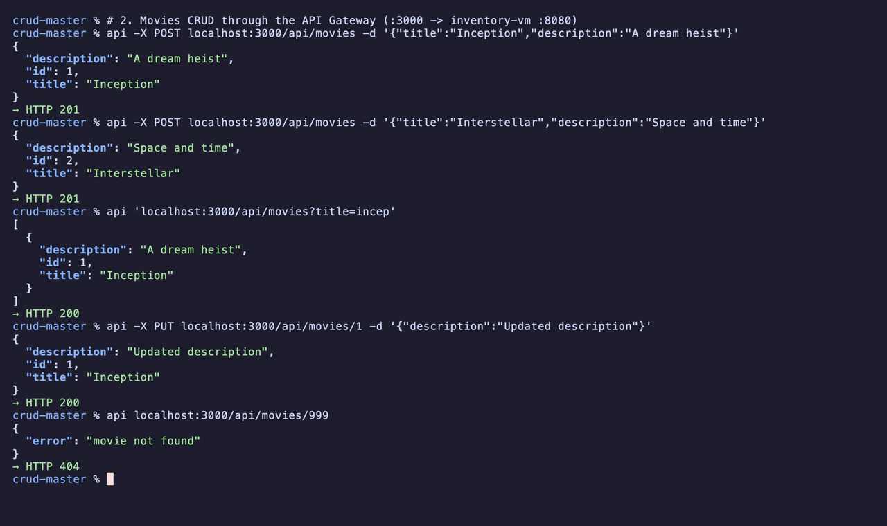
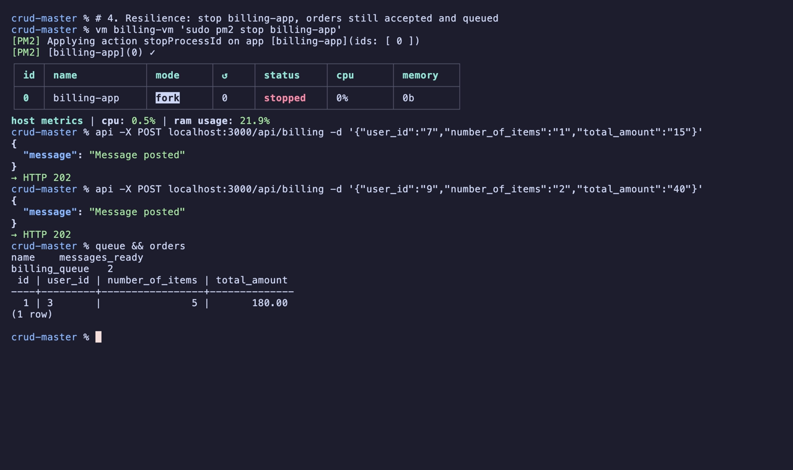
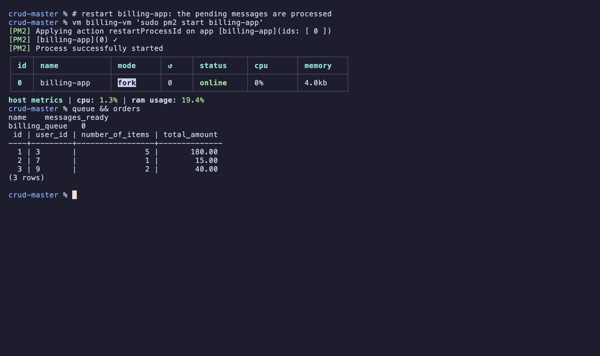
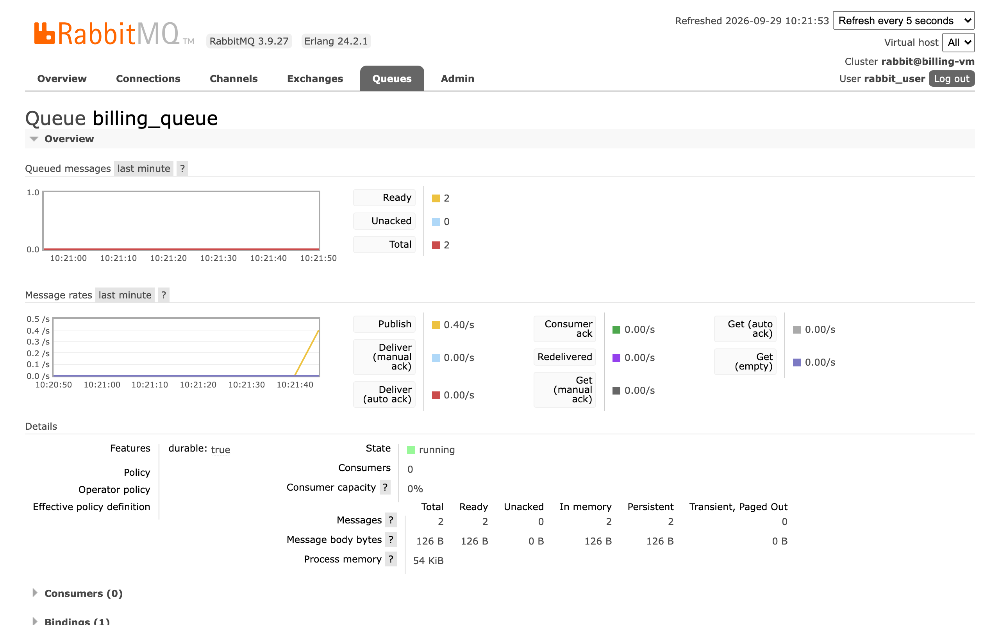
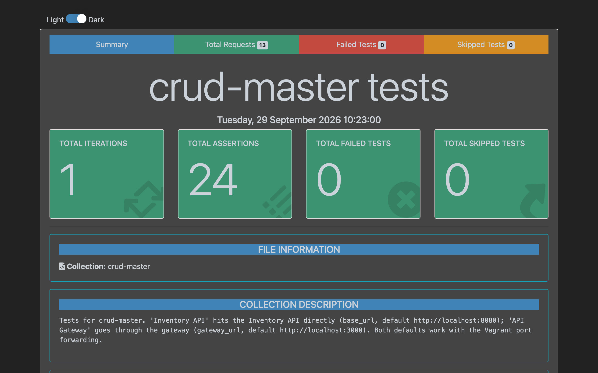

# crud-master

A movie streaming platform built as three Python microservices behind an API Gateway.
Each service runs in its own Vagrant VM, managed by PM2.



| Service | What it does | Talks over |
|---|---|---|
| **API Gateway** | Single entry point for clients | HTTP to Inventory, RabbitMQ to Billing |
| **Inventory API** | CRUD over movies in PostgreSQL | HTTP (Flask, port 8080) |
| **Billing API** | Stores orders taken from the queue | RabbitMQ only, no HTTP |

## Quick start

Requires VirtualBox and Vagrant. See [the deployment guide](docs/deployment.md#tools) for the full tools list.

```bash
git clone https://learn.reboot01.com/git/aalasmawi/crud-master
cd crud-master
vagrant up
```

Once the three VMs are up, you can reach:

| URL | What |
|---|---|
| http://localhost:3000/api/movies | API Gateway |
| http://localhost:8080/api/movies | Inventory API (direct) |
| http://localhost:15672 | RabbitMQ UI (login from `.env`: `RABBITMQ_USER` / `RABBITMQ_PASSWORD`) |

To try it:

```bash
curl -X POST http://localhost:3000/api/movies -H "Content-Type: application/json" \
  -d '{"title":"Inception","description":"A dream heist"}'

curl -X POST http://localhost:3000/api/billing -H "Content-Type: application/json" \
  -d '{"user_id":"3","number_of_items":"5","total_amount":"180"}'
```

## Test results

All checks below were run against the three Vagrant VMs on 2026-09-29.


Full-quality video: [docs/media/demo.mp4](docs/media/demo.mp4). To re-record it, run
`vhs docs/media/demo.tape`.

| Check | Result |
|---|---|
| `vagrant status`: 3 VMs | ✅ inventory-vm, billing-vm, gateway-vm running |
| `sudo pm2 list` on each VM | ✅ inventory-app, billing-app, api-gateway-app online |
| Movies CRUD through the gateway | ✅ 201 create, 200 filter/get/update/delete, 404 unknown id |
| `POST /api/billing` | ✅ 202 "Message posted", row stored in `orders` |
| Invalid order | ✅ 400 `missing fields: ...`, never queued |
| billing-app stopped | ✅ gateway still answers 202, messages wait in `billing_queue`, `orders` unchanged |
| billing-app restarted | ✅ pending messages processed, queue back to 0 |
| Publish via RabbitMQ UI / `rabbitmqadmin` | ✅ order stored |
| Postman collection (newman) | ✅ 13 requests, 24 assertions, **0 failures** ([HTML report](docs/media/postman-report.html)) |
| OpenAPI spec | ✅ valid OpenAPI 3.0, renders in Swagger UI |

| | |
|---|---|
| <br>VMs and PM2 | <br>Movies through the gateway |
| <br>Billing stopped: orders queued | <br>Billing restarted: orders stored |
| <br>RabbitMQ: 2 messages waiting, 0 consumers | <br>Postman: 24/24 assertions pass |

More screenshots: [docs/testing.md](docs/testing.md#recorded-results).

## Documentation

| Document | Contents |
|---|---|
| [docs/architecture.md](docs/architecture.md) | Components, request flows, data model, failure handling, design choices |
| [docs/deployment.md](docs/deployment.md) | Tools, `.env` variables, Vagrant, provisioning, PM2, running without VMs |
| [docs/testing.md](docs/testing.md) | Postman collection, billing tests, resilience walkthrough |
| [openapi.yaml](openapi.yaml) | OpenAPI 3 spec of the API Gateway (open in [Swagger Editor](https://editor.swagger.io/)) |

## API at a glance

All client requests go through the gateway.

| Method | Path | Description |
|---|---|---|
| GET | `/api/movies` | List all movies; `?title=name` filters by title |
| POST | `/api/movies` | Create a movie |
| DELETE | `/api/movies` | Delete all movies |
| GET | `/api/movies/{id}` | Get one movie |
| PUT | `/api/movies/{id}` | Update one movie |
| DELETE | `/api/movies/{id}` | Delete one movie |
| POST | `/api/billing` | Queue an order → `{"message": "Message posted"}` |

## Stack

- **Python 3**: Flask, SQLAlchemy, requests, pika, python-dotenv
- **PostgreSQL**: `movies_db` and `billing_db`
- **RabbitMQ**: `billing_queue`, with the management UI
- **PM2**: process manager for the three apps
- **Vagrant + VirtualBox**: three Ubuntu 22.04 VMs
- **OpenAPI 3 + Postman**: API docs and tests

## Project structure

```
.
├── README.md
├── .env                  # all configuration and credentials (committed per the subject)
├── Vagrantfile           # defines the 3 VMs, fed by .env
├── openapi.yaml          # API Gateway documentation
├── docs/                 # architecture, deployment, testing guides
│   └── media/            # screenshots, demo recording, Postman report
├── postman/              # exported Postman collection
├── scripts/              # VM provisioning (see docs/deployment.md)
└── srcs/
    ├── api-gateway-app/  # app/, requirements.txt, server.py
    ├── billing-app/      # app/, requirements.txt, server.py
    └── inventory-app/    # app/, requirements.txt, server.py
```

The subject's example tree includes a `config.yaml`. This project has no separate config file:
`.env` holds all configuration, and `openapi.yaml` holds the API documentation.
