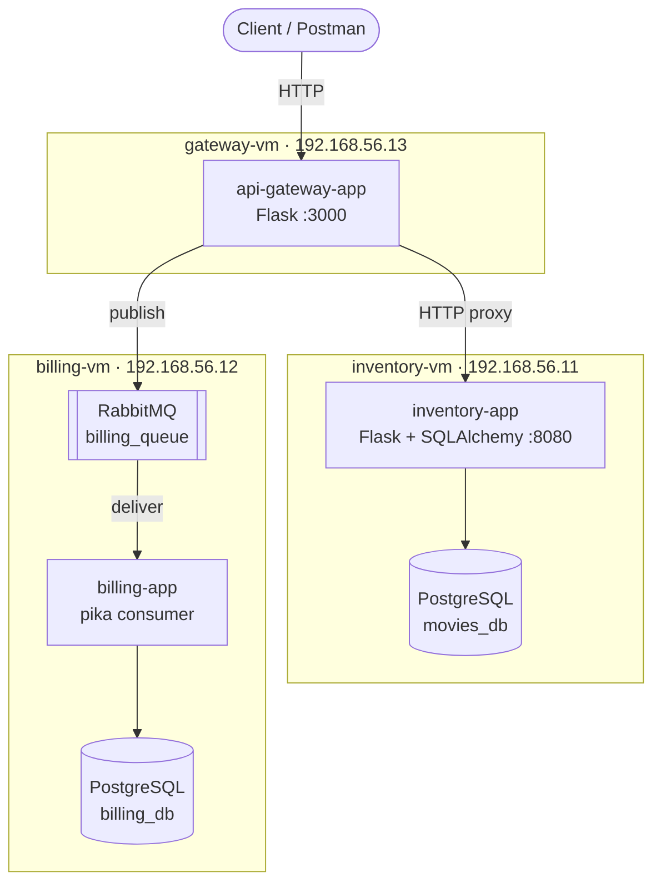
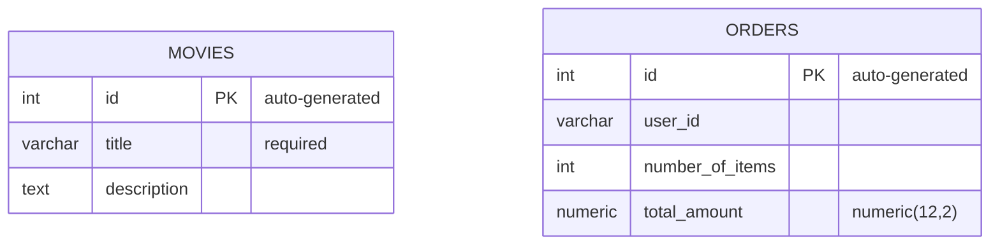
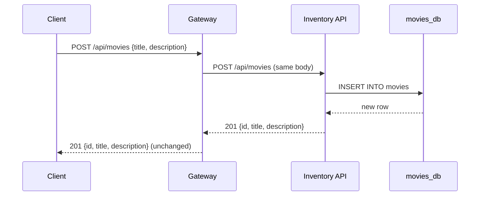
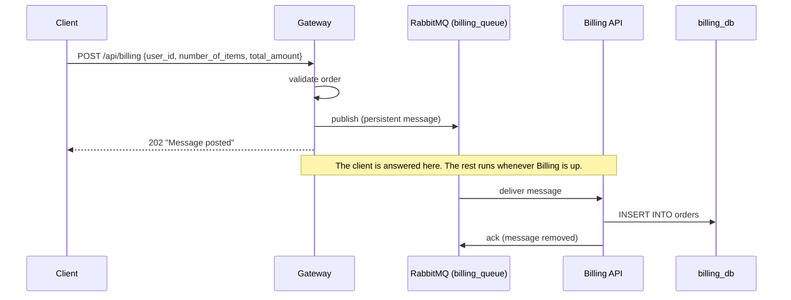

# Architecture

## Overview

Each VM holds only what its service needs. RabbitMQ lives on billing-vm, next to the only
service that consumes from it.

## Components

### API Gateway (`srcs/api-gateway-app`)

The only service clients talk to. It has two jobs.

- **Movies: HTTP proxy.** Any request to `/api/movies` or `/api/movies/{id}` is forwarded to
  the Inventory API.
  - Method, query string, raw body and `Content-Type` are forwarded unchanged.
  - Inventory's status code and body are returned unchanged.
  - The gateway does not check the data it forwards; if Inventory can't be reached, it answers `502`.
- **Billing: queue publisher.** On `POST /api/billing`:
  1. The gateway checks the body is a valid order: a JSON object with `user_id`, an integer
     `number_of_items` and a numeric `total_amount`.
  2. It publishes the body to `billing_queue` and answers `202 {"message": "Message posted"}`.
  3. Invalid orders get `400` and never reach the queue.

| File | Role |
|---|---|
| `app/routes.py` | Routes, proxying, order validation |
| `app/rabbitmq.py` | Publishing to RabbitMQ |

### Inventory API (`srcs/inventory-app`)

A REST CRUD API over the `movies` table.

- Flask handles HTTP and Flask-SQLAlchemy handles the ORM.
- The table is created at startup with `create_all`.
- `title` is required and must be a non-empty string.

| File | Role |
|---|---|
| `app/__init__.py` | App factory, database connection |
| `app/models.py` | The `Movie` model |
| `app/routes.py` | The 7 endpoints |

### Billing API (`srcs/billing-app`)

A RabbitMQ consumer with no HTTP server; the subject says it receives messages exclusively
through RabbitMQ. For each message it:

1. parses the JSON into an `Order`,
2. inserts the order into `orders`,
3. acknowledges the message.

On startup, it consumes everything already waiting in the queue before handling new messages.

| File | Role |
|---|---|
| `app/consumer.py` | Connection, message handling, ack/nack |
| `app/db.py` | The `Order` model, database session |

## Data model

- `movies` lives in `movies_db` on inventory-vm.
- `orders` lives in `billing_db` on billing-vm.
- The two databases are separate and each is owned by its own service.

## Request flows

### Movies

### Billing

The client's answer never depends on the Billing API. If billing-app is stopped, messages wait in
the queue. When it restarts, it consumes the backlog in order.

## Failure handling

| Situation | What happens |
|---|---|
| billing-app stopped | Gateway still answers `202`; messages wait in the durable queue and are processed on restart |
| RabbitMQ restarted | The queue is durable and messages are persistent, so nothing queued is lost |
| Invalid order sent to the gateway | `400`, not published |
| Invalid message published directly to the queue | Billing logs it and rejects it without requeueing, so it can't block the messages behind it |
| `billing_db` unavailable | The message is requeued after 3 s and retried; it is never lost |
| Inventory API down | Gateway answers `502 {"error": "inventory service unavailable"}` |
| RabbitMQ unreachable from the gateway | `502 {"error": "message broker unavailable"}` |
| Any app crashes | PM2 restarts it (3 s delay) |
| VM reboots | PM2's systemd unit restores the saved process list |

## Design choices

- **The gateway never calls billing-app directly.** It only publishes to RabbitMQ, so "accept
  billing requests while Billing is down" needs no extra code: RabbitMQ holds the messages.
- **Messages are acknowledged only after the database commit.** A crash before the commit means
  the message is delivered again, so orders are processed at least once.
- **Consumer prefetch is 1.** Billing handles one message at a time, in queue order.
- **Orders are checked twice.** The gateway checks orders so clients get a clear `400`.
  Billing checks again because anyone can publish to the queue directly.
- **Amounts use exact decimals.** `total_amount` goes through `Decimal` into `numeric(12,2)`,
  never through `float`.
- **All configuration lives in `.env`.** No credentials appear in code, the Vagrantfile or the
  scripts. See [deployment](deployment.md#environment-variables).
- **RabbitMQ uses a dedicated user, not `guest`.** `guest` can only log in from localhost, and the
  gateway connects from another VM.
- **Each app has its own virtual environment** with its own `requirements.txt`, so no
  dependencies are shared between services.
- **The Flask development server is used.** It is fine for this development setup under PM2.
  A production deployment would use gunicorn (or similar), not Vagrant.
