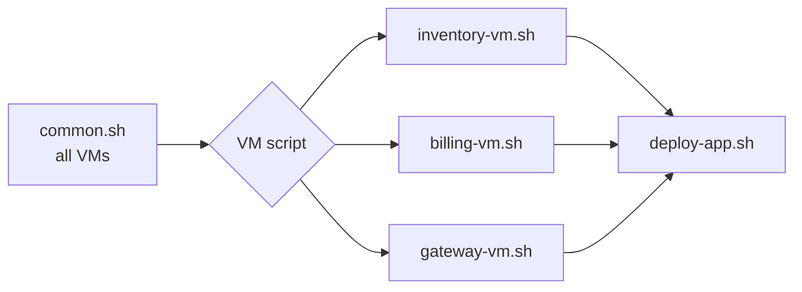

# Deployment

## Tools

Install these on the host machine:

| Tool | Version | Used for |
|---|---|---|
| [VirtualBox](https://www.virtualbox.org/wiki/Downloads) | 7.x | Running the VMs |
| [Vagrant](https://developer.hashicorp.com/vagrant/install) | 2.4+ | `vagrant up`, `vagrant status`, `vagrant ssh` |
| [Postman](https://www.postman.com/downloads/) or [newman](https://www.npmjs.com/package/newman) | any | Running the test collection |
| Git | any | Cloning the repository |

Everything else is installed inside the VMs by the provisioning scripts: Python 3, PostgreSQL,
RabbitMQ, Node.js 22 and PM2.

> **Apple Silicon (M-series) Macs:** the default box `ubuntu/jammy64` is x86-only and won't boot.
> Set `VAGRANT_BOX` in `.env` to an arm64 Ubuntu 22.04 box for your provider.

## Environment variables

`.env` at the repository root is the single source of configuration. The subject requires it
to be committed.

- **Vagrant** reads it and passes each VM only the variables that VM needs.
- **Each `server.py`** also loads it, so `python server.py` works outside the VMs.
- Variables that are already set (e.g. by PM2 in the VMs) take precedence over `.env`.

| Variable | Default | Used by |
|---|---|---|
| `VAGRANT_BOX` | `ubuntu/jammy64` | Vagrantfile |
| `INVENTORY_VM_IP` | `192.168.56.11` | Vagrantfile |
| `BILLING_VM_IP` | `192.168.56.12` | Vagrantfile |
| `GATEWAY_VM_IP` | `192.168.56.13` | Vagrantfile |
| `INVENTORY_DB_HOST` | `localhost` | inventory-app |
| `INVENTORY_DB_PORT` | `5432` | inventory-app |
| `INVENTORY_DB_NAME` | `movies_db` | inventory-app, provisioning |
| `INVENTORY_DB_USER` | `inventory_user` | inventory-app, provisioning |
| `INVENTORY_DB_PASSWORD` | `inventory_pass` | inventory-app, provisioning |
| `BILLING_DB_HOST` | `localhost` | billing-app |
| `BILLING_DB_PORT` | `5432` | billing-app |
| `BILLING_DB_NAME` | `billing_db` | billing-app, provisioning |
| `BILLING_DB_USER` | `billing_user` | billing-app, provisioning |
| `BILLING_DB_PASSWORD` | `billing_pass` | billing-app, provisioning |
| `RABBITMQ_HOST` | `localhost` | billing-app, gateway (*) |
| `RABBITMQ_PORT` | `5672` | billing-app, gateway |
| `RABBITMQ_MANAGEMENT_PORT` | `15672` | Vagrantfile (host port for the UI) |
| `RABBITMQ_USER` | `rabbit_user` | billing-app, gateway, RabbitMQ UI, provisioning |
| `RABBITMQ_PASSWORD` | `rabbit_pass` | billing-app, gateway, RabbitMQ UI, provisioning |
| `BILLING_QUEUE` | `billing_queue` | billing-app, gateway, provisioning |
| `INVENTORY_APP_HOST` | `0.0.0.0` | inventory-app |
| `INVENTORY_APP_PORT` | `8080` | inventory-app, Vagrantfile |
| `GATEWAY_APP_HOST` | `0.0.0.0` | gateway |
| `GATEWAY_APP_PORT` | `3000` | gateway, Vagrantfile |
| `INVENTORY_API_URL` | `http://localhost:8080` | gateway (*) |

(*) On gateway-vm the Vagrantfile builds these from the VM IPs:

- `RABBITMQ_HOST` becomes `BILLING_VM_IP`.
- `INVENTORY_API_URL` becomes `http://INVENTORY_VM_IP:INVENTORY_APP_PORT`.

The values in `.env` are the ones used for local runs.

## Virtual machines

| VM | IP | Runs | Forwarded to host |
|---|---|---|---|
| `inventory-vm` | 192.168.56.11 | inventory-app, PostgreSQL (`movies_db`) | `localhost:8080` |
| `billing-vm` | 192.168.56.12 | billing-app, PostgreSQL (`billing_db`), RabbitMQ | `localhost:15672` (UI) |
| `gateway-vm` | 192.168.56.13 | api-gateway-app | `localhost:3000` |

From the project root:

```bash
vagrant up                 # create + provision all VMs (first run takes several minutes)
vagrant status             # all three should be "running"
vagrant ssh billing-vm     # shell into a VM
```

After changing `.env` or a script, re-run provisioning:

```bash
vagrant provision
```

Other lifecycle commands:

```bash
vagrant halt               # stop the VMs
vagrant destroy -f         # delete the VMs
```

## Provisioning

The scripts in `scripts/` run in this order:



| Script | What it does |
|---|---|
| `common.sh` | Installs Python 3 + venv, Node.js 22 and PM2 on every VM |
| `inventory-vm.sh` | Installs PostgreSQL, creates the `inventory_user` role and `movies_db` |
| `billing-vm.sh` | Installs PostgreSQL and RabbitMQ; see below |
| `gateway-vm.sh` | Nothing extra: the gateway has no database |
| `deploy-app.sh <app>` | Creates the venv in `/opt/venvs/<app>` (on the VM's disk, since pip fails inside the `/vagrant` shared folder), installs `requirements.txt`, starts the app under PM2, saves the PM2 process list and registers the PM2 systemd unit |

`billing-vm.sh` does the following:

- creates the `billing_user` role and `billing_db`
- enables the RabbitMQ management UI and installs `rabbitmqadmin`
- creates `RABBITMQ_USER`
- declares the durable `billing_queue`

The scripts can be re-run safely. The tables (`movies`, `orders`) are created by the apps when
they start.

## Managing apps with PM2

PM2 runs as root inside each VM, so use `sudo`:

```bash
sudo pm2 list                     # status of the app on this VM
sudo pm2 logs billing-app         # follow its logs
sudo pm2 stop billing-app
sudo pm2 start billing-app
sudo pm2 restart billing-app
```

| VM | PM2 app name |
|---|---|
| inventory-vm | `inventory-app` |
| billing-vm | `billing-app` |
| gateway-vm | `api-gateway-app` |

## Running without VMs

For fast iteration, you can run the services directly on your machine.

1. Install PostgreSQL and RabbitMQ locally, and create the roles, databases and RabbitMQ user
   listed in `.env`:

   ```bash
   sudo -u postgres psql -c "CREATE ROLE inventory_user LOGIN PASSWORD 'inventory_pass';"
   sudo -u postgres psql -c "CREATE DATABASE movies_db OWNER inventory_user;"
   sudo -u postgres psql -c "CREATE ROLE billing_user LOGIN PASSWORD 'billing_pass';"
   sudo -u postgres psql -c "CREATE DATABASE billing_db OWNER billing_user;"
   sudo rabbitmqctl add_user rabbit_user rabbit_pass
   sudo rabbitmqctl set_permissions -p / rabbit_user ".*" ".*" ".*"
   ```

2. Start each service in its own terminal, from its directory:

   ```bash
   cd srcs/inventory-app          # then billing-app, then api-gateway-app
   python3 -m venv venv
   source venv/bin/activate
   pip install -r requirements.txt
   python server.py
   ```

   `server.py` loads the root `.env` automatically.

## Troubleshooting

| Symptom | Check |
|---|---|
| `POST /api/billing` returns 502 | Is RabbitMQ running on billing-vm (`systemctl status rabbitmq-server`)? Does `RABBITMQ_USER` exist (`sudo rabbitmqctl list_users`)? |
| `/api/movies` returns 502 | Is inventory-app running (`sudo pm2 list` on inventory-vm)? |
| `sudo pm2 list` is empty | Run `vagrant provision <vm>` |
| An app shows `errored` in PM2 | Read `sudo pm2 logs <app>`. It is usually the database being unreachable. |
| `vagrant up` fails on a port collision | Another program is using 3000, 8080 or 15672; change the port in `.env` |
