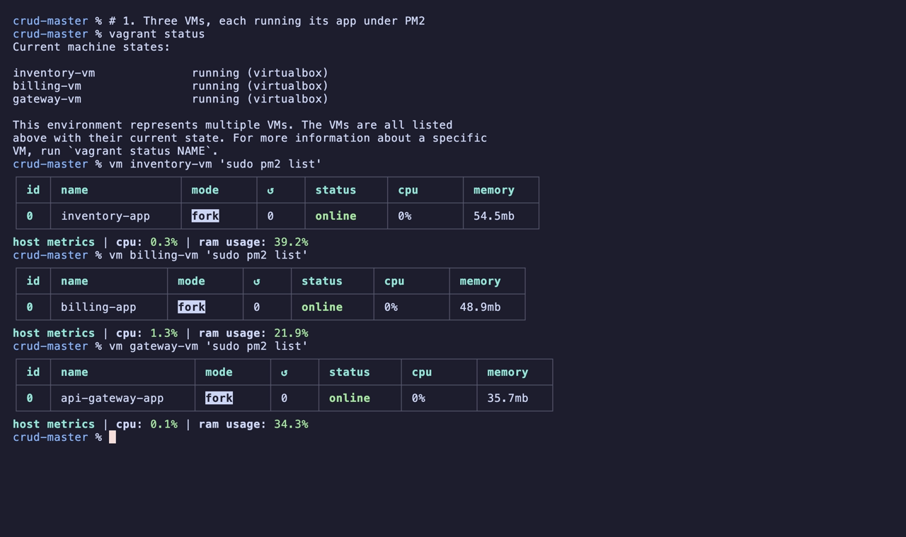
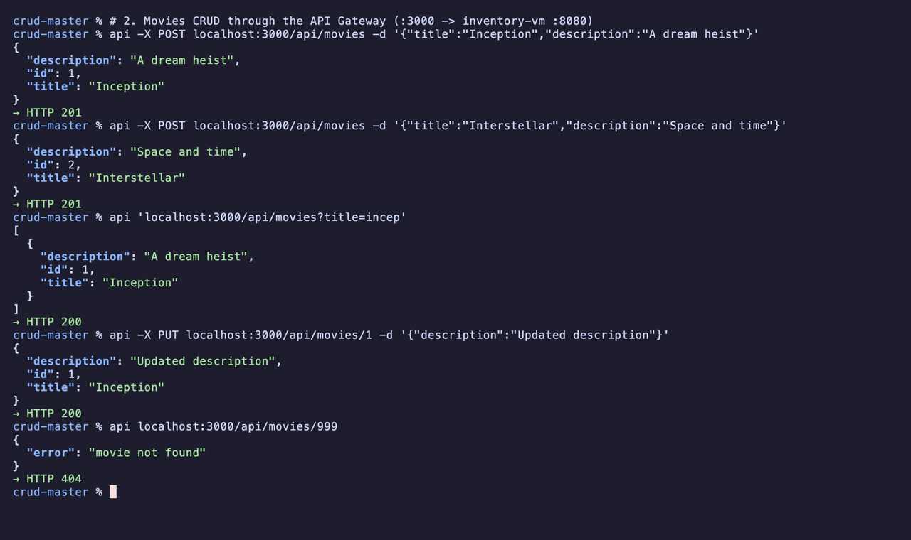
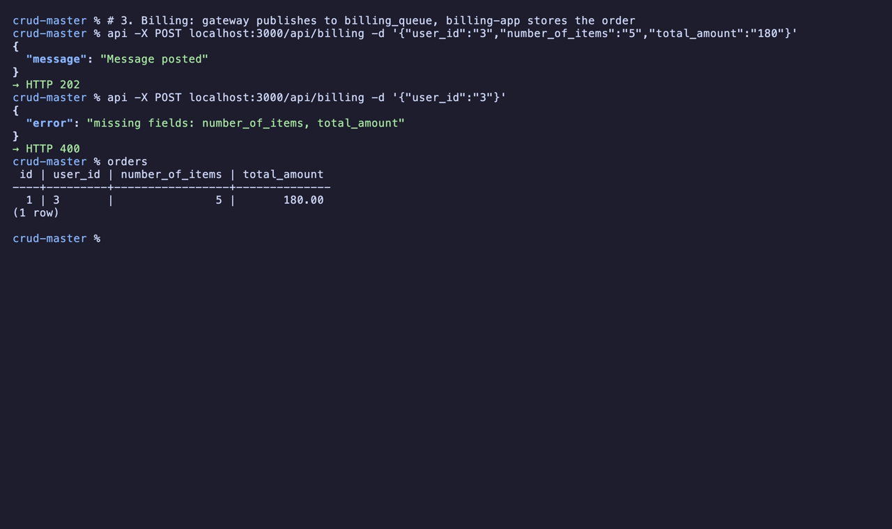
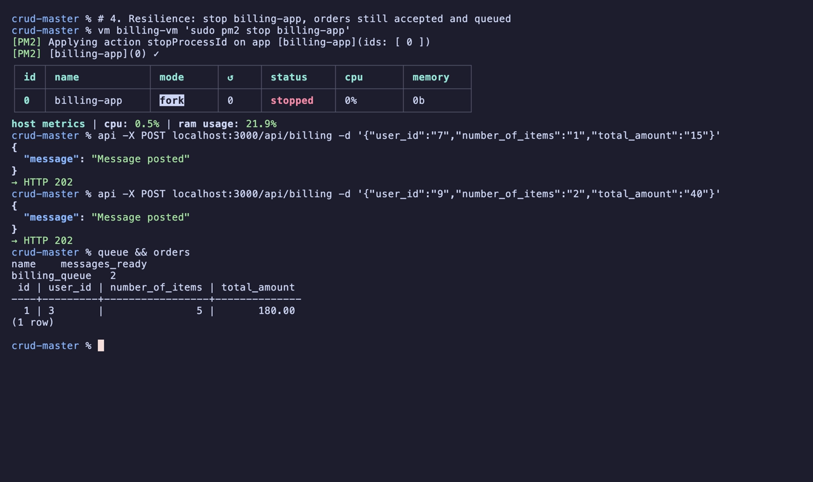
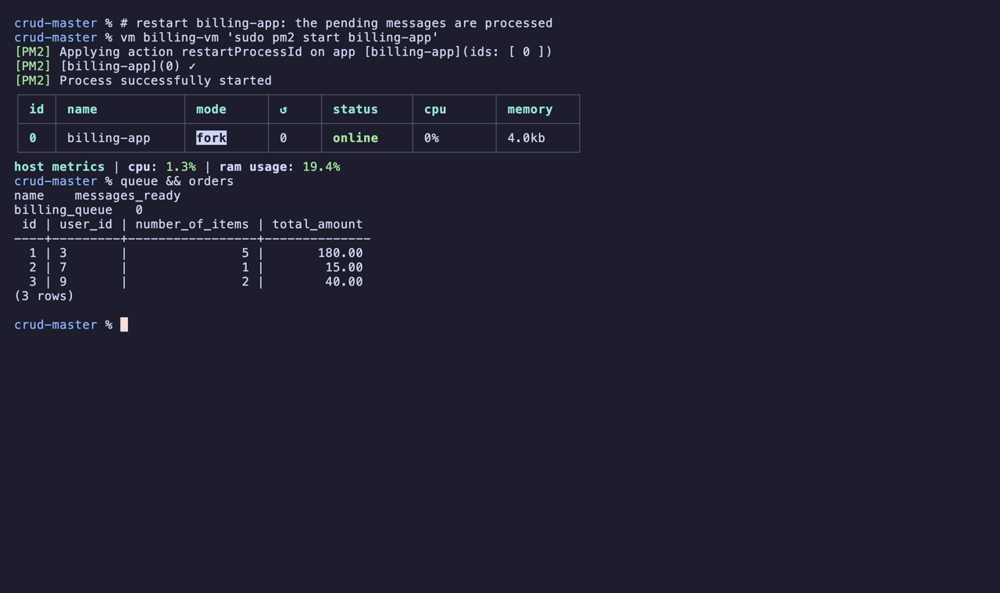
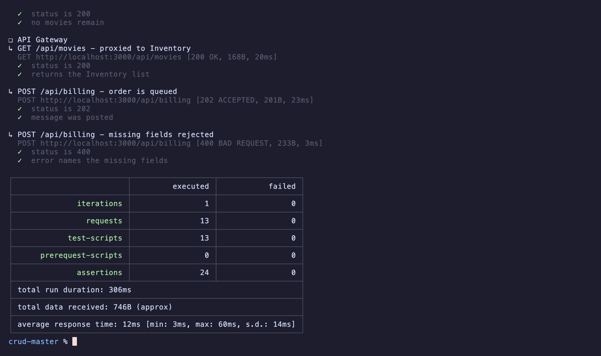
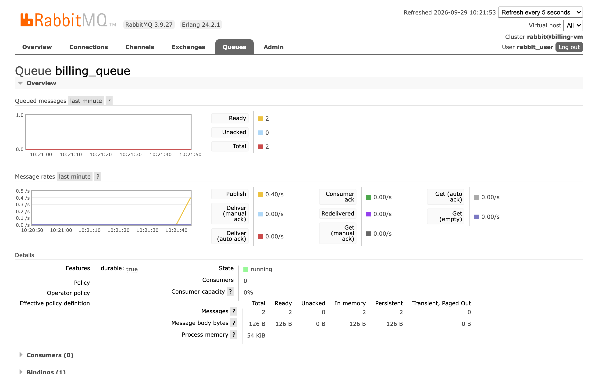
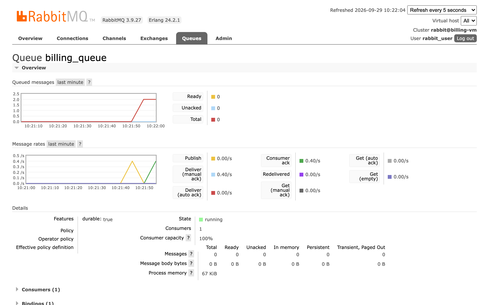
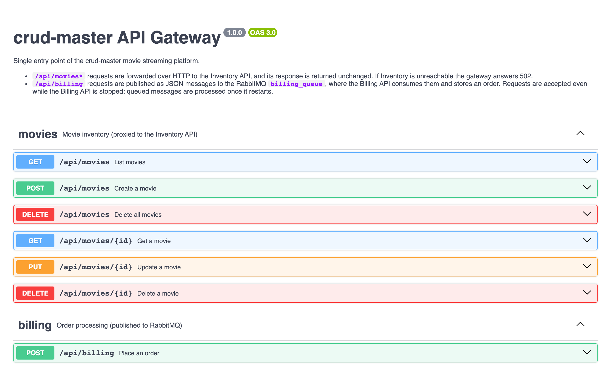
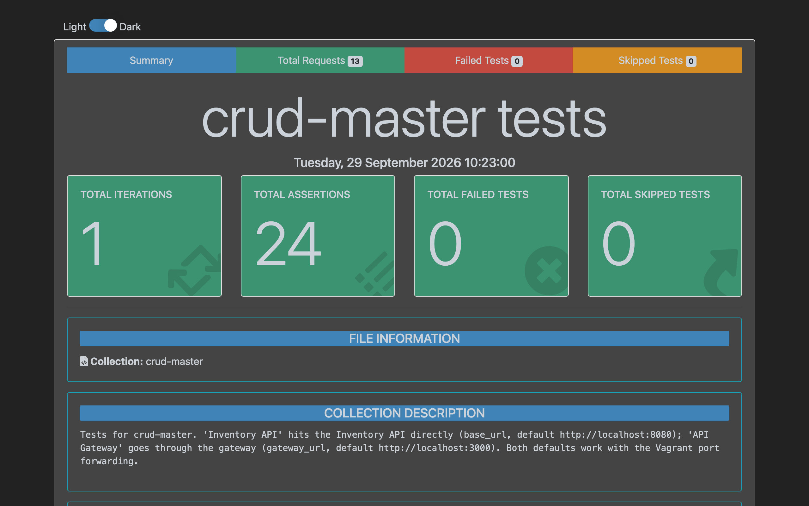

# Testing

All commands assume the VMs are up (`vagrant up`) and are run from the host unless noted.

## 1. Postman collection

The collection is `postman/crud-master.postman_collection.json`. It contains two folders:

| Folder | Target | Covers |
|---|---|---|
| **Inventory API** | `{{base_url}}` = `http://localhost:8080` | All 7 endpoints: create, list, filter by title, get by id (and 404), update, delete one, delete all |
| **API Gateway** | `{{gateway_url}}` = `http://localhost:3000` | Movie proxying, a valid billing order (`202 Message posted`), an invalid order (`400`) |

Every request has at least one test.

To run it in **Postman**, import the file, then click **Run collection**. Requests in the
Inventory folder must run in order, because later ones reuse the id created by the first.

To run it from the **command line**:

```bash
newman run postman/crud-master.postman_collection.json
```

To send the Inventory folder through the gateway instead, change `base_url` to
`http://localhost:3000`.

## 2. Billing through the gateway

```bash
curl -i -X POST http://localhost:3000/api/billing \
  -H "Content-Type: application/json" \
  -d '{"user_id":"3","number_of_items":"5","total_amount":"180"}'
```

Expected: `202 {"message": "Message posted"}`.

Then check the new row on billing-vm:

```bash
vagrant ssh billing-vm -c "sudo -u postgres psql billing_db -c 'SELECT * FROM orders;'"
```

## 3. Publishing directly to the queue

This path bypasses the gateway. Use either the UI or the CLI.

**RabbitMQ UI:**

1. Open http://localhost:15672 and log in with `RABBITMQ_USER` / `RABBITMQ_PASSWORD` from `.env`.
2. Go to **Queues** → `billing_queue` → **Publish message**.
3. Paste the payload and click **Publish message**:

   ```json
   {"user_id": "7", "number_of_items": "2", "total_amount": "40"}
   ```

**CLI (inside billing-vm):**

```bash
rabbitmqadmin -u rabbit_user -p rabbit_pass publish exchange=amq.default \
  routing_key=billing_queue payload='{"user_id":"7","number_of_items":"2","total_amount":"40"}'
```

The row appears in `orders` right away.

A malformed message is rejected: `sudo pm2 logs billing-app` shows `Discarding message`, and it
does not block the messages behind it.

## 4. Resilience: billing-app stopped

This is the key scenario from the subject.

1. On billing-vm, stop the consumer:

   ```bash
   vagrant ssh billing-vm
   sudo pm2 stop billing-app
   ```

2. From the host, send an order:

   ```bash
   curl -X POST http://localhost:3000/api/billing -H "Content-Type: application/json" \
     -d '{"user_id":"9","number_of_items":"1","total_amount":"15"}'
   ```

   The gateway still answers `Message posted`.

3. On billing-vm, the order is **not** in the table yet:

   ```bash
   sudo -u postgres psql billing_db -c "SELECT * FROM orders;"
   ```

   In the RabbitMQ UI, `billing_queue` shows 1 message **Ready**.

4. Restart the consumer:

   ```bash
   sudo pm2 start billing-app
   ```

5. Run the same `SELECT` again. The pending order now appears, and the queue is back to 0.

## 5. Checklist

| Check | Command / place | Expected |
|---|---|---|
| VMs running | `vagrant status` | inventory-vm, billing-vm, gateway-vm: running |
| Apps running | `sudo pm2 list` in each VM | App `online` |
| Inventory at :8080 | `curl localhost:8080/api/movies` | `200 []` or a list |
| Gateway proxies movies | `curl localhost:3000/api/movies` | Same result as the line above |
| Postman tests | Collection runner / newman | All tests pass |
| Billing through gateway | Section 2 | `202`, new row in `orders` |
| Queue publish via UI/CLI | Section 3 | New row in `orders` |
| Billing down, gateway up | Section 4 | `202` while stopped, row appears after restart |
| API documentation | `openapi.yaml` in Swagger Editor | All endpoints described |
| No hardcoded credentials | `grep -rn pass srcs/` | Only `os.environ` reads |

## Recorded results

These were captured on 2026-09-29 against the three VMs. The terminal parts come from
`docs/media/demo.tape`: run `vhs docs/media/demo.tape` from the project root to re-record them.

| Step | Screenshot |
|---|---|
| VMs and PM2 apps running |  |
| Movies CRUD through the gateway |  |
| Billing through the gateway, invalid order rejected |  |
| billing-app stopped: orders accepted, 2 waiting in the queue |  |
| billing-app restarted: queue drained, orders stored |  |
| Postman collection with newman |  |
| RabbitMQ UI while billing-app is stopped (2 ready, 0 consumers) |  |
| RabbitMQ UI after restart (queue empty) |  |
| OpenAPI spec rendered in Swagger UI |  |
| Postman HTML report ([open](media/postman-report.html)) |  |

Full recording: [demo.gif](media/demo.gif) · [demo.mp4](media/demo.mp4)
